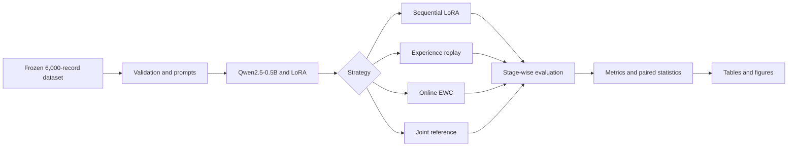
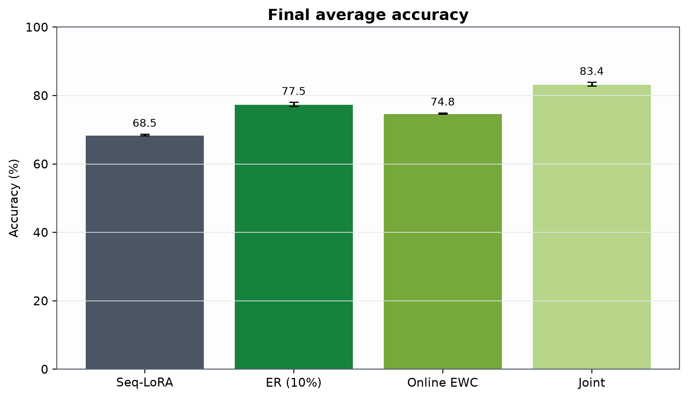
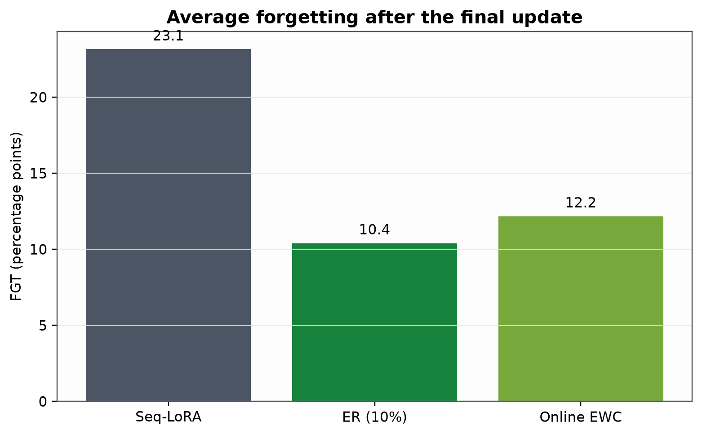
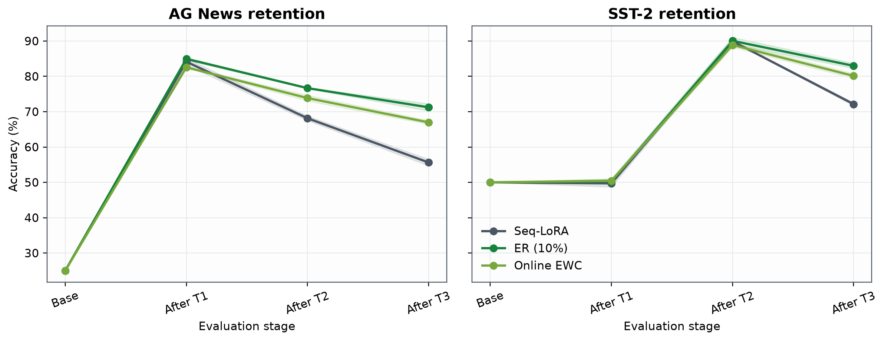
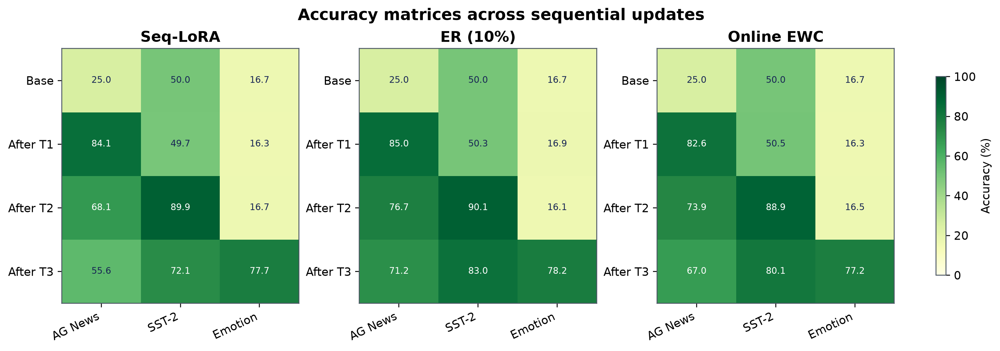
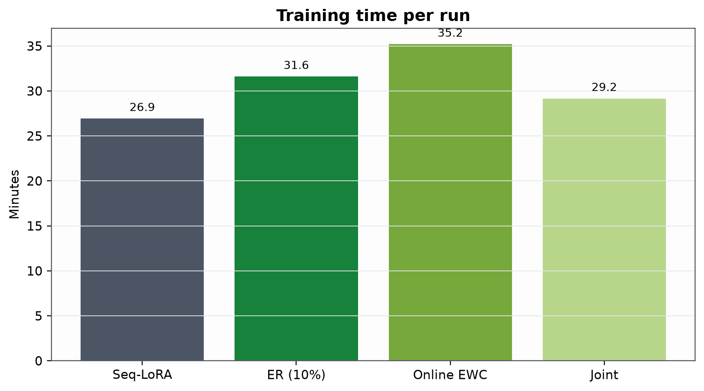
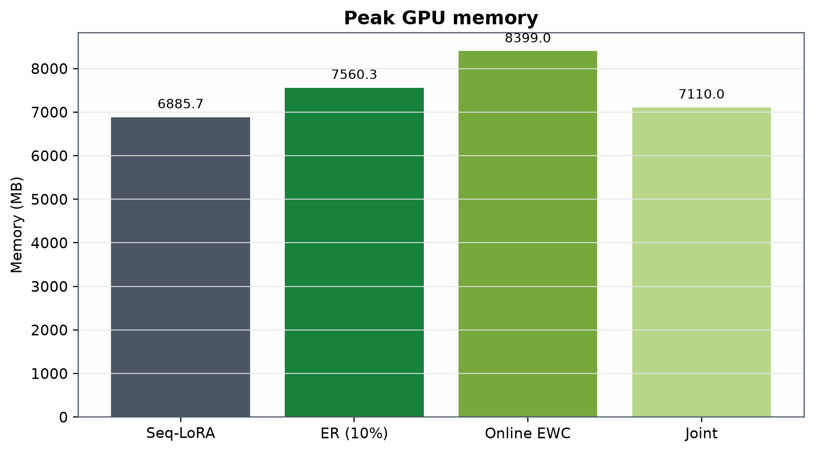
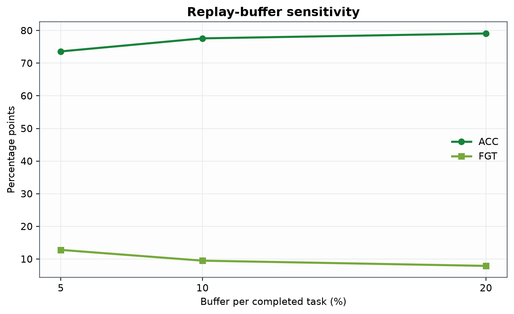
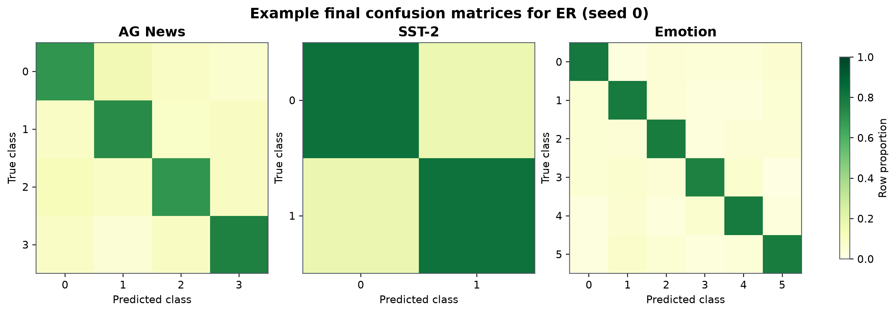
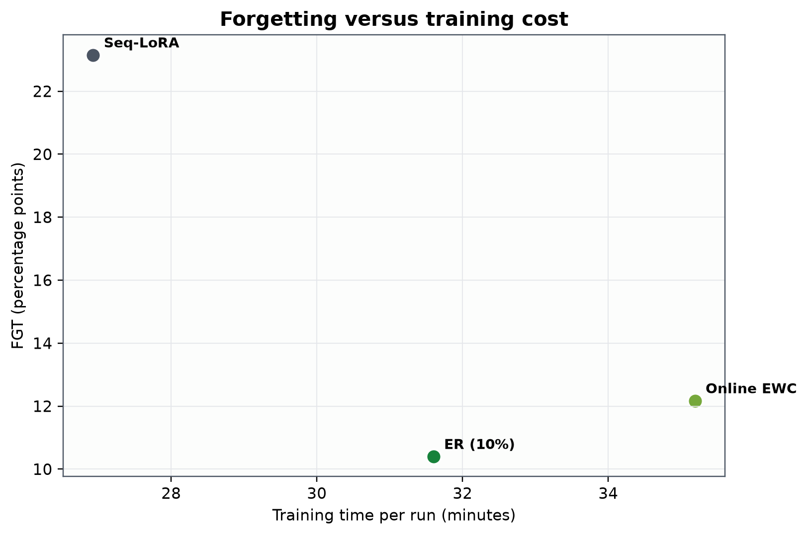

# Comparing Continual Fine-Tuning Strategies for Mitigating Catastrophic Forgetting in Resource-Constrained Language Models

Astana IT University  
Research Methods and Tools  
Group SE-2418  
Mirzanov Temirlan, Turemuratov Galymzhan, and Abdikul Bakdaulet

## Overview

Sequential model updates can replace useful behavior learned from earlier tasks.
This effect is catastrophic forgetting. The project provides a controlled benchmark
for testing whether experience replay or online Elastic Weight Consolidation can
retain earlier task performance better than standard sequential LoRA under a fixed
resource budget.

The implementation uses one compact decoder model, three English classification
tasks, one task order, and one shared evaluation procedure. It records both
retention and resource cost so that a method cannot appear preferable by reporting
accuracy alone.

## Research question

> How do replay-based and regularization-based continual fine-tuning approaches
> compare with standard sequential LoRA fine-tuning in mitigating catastrophic
> forgetting in open-source language models under limited computational resources?

## Research hypotheses

- H1: Replay-based and regularization-based continual fine-tuning will produce lower catastrophic forgetting than standard sequential LoRA fine-tuning under the same sequential task setting
- H2: Replay-based continual fine-tuning will improve knowledge retention relative to standard sequential LoRA but will require additional storage and/or training computation, producing a different retention-resource trade-off from regularization-based continual fine-tuning

## Research approach

The study is a quantitative controlled comparative benchmark. The model, dataset
subsets, prompt, LoRA configuration, optimizer, task order, hardware class, and
evaluation procedure remain fixed. Only the adaptation strategy changes.



## Experimental setup

| Component | Frozen value |
| --- | --- |
| Model | `Qwen/Qwen2.5-0.5B` |
| Task order | AG News, SST-2, Emotion |
| Main seeds | 0, 1, 2 |
| LoRA | rank 8, alpha 16, dropout 0.05 |
| Target modules | q, k, v, and o projections |
| Optimizer | AdamW, learning rate 2e-4 |
| Training | 2 epochs per task, effective batch 16 |
| Schedule | 10% warm-up, linear decay |
| Gradient clipping | 1.0 |
| Sequence limits | 160 total tokens, 96 text tokens |
| Replay | 10% of each completed task, class-stratified |
| EWC | 200 Fisher samples, mean-one normalization |
| EWC grid | 0.01, 0.1, 1, 10, 100 with seed 1000 |
| Planned runs | 12 main, 5 EWC calibration, 2 replay sensitivity |

## Dataset

The frozen dataset contains 6,000 unique records sampled with seed 1234. Every
task has 1,000 training records, 200 validation records, and 800 test records.

| Task | Source | Labels | Total |
| --- | --- | --- | ---: |
| AG News | `fancyzhx/ag_news` | World, Sports, Business, Sci/Tech | 2,000 |
| SST-2 | `nyu-mll/glue`, config `sst2` | Negative, Positive | 2,000 |
| Emotion | `dair-ai/emotion`, config `split` | Sadness, Joy, Love, Anger, Fear, Surprise | 2,000 |

Example frozen records:

| Record ID | Task | Label | Text preview |
| --- | --- | --- | --- |
| `T1_train_0109725` | AG News | Sci/Tech | Professor declined to be expert witness for Sharman Networks... |
| `T2_train_0036747` | SST-2 | Negative | her appear foolish and shallow rather than... |
| `T3_train_0000785` | Emotion | Sadness | Text omitted from repository documentation |

The CSV SHA-256 is
`75da6e2427b6ebc2418422f5b95bb47442f8d373d98697dd8f52159fe574cb82`.
The source revisions, split hashes, distribution, and validation result are in
[`data/manifests`](data/manifests/).

## Methods

### Sequential LoRA

One adapter learns AG News, SST-2, and Emotion in order. Each stage evaluates all
three test sets. This is the continual-learning baseline.

### Experience replay

After each task, the method stores a class-stratified 10% sample. Later stages mix
the complete buffer with the current task. The implementation records buffer count,
class distribution, storage bytes, and added optimizer work.

### Online EWC

After each task, the method estimates a diagonal empirical Fisher from 200
per-example gradients over trainable LoRA parameters. It normalizes the estimate to
mean one, accumulates it online, stores parameter anchors, and adds the penalty
`lambda / 2 * sum(F * (theta - theta_star)^2)` during later training.

### Joint training

The reference condition trains on all 3,000 training records for two epochs. It is
not a continual method and does not receive LA, BWT, or FGT values.

## Deterministic example results

The repository includes a reproducible example package generated with seed
20261110. It demonstrates every schema, calculation, table, and figure.

| Method | ACC (%) | Macro-F1 (%) | FGT (pp) | Time (min) | Peak memory (MB) |
| --- | ---: | ---: | ---: | ---: | ---: |
| Seq-LoRA | 68.50 +/- 0.26 | 68.50 +/- 0.26 | 23.15 | 26.93 | 6,885.7 |
| ER (10%) | 77.48 +/- 0.60 | 77.47 +/- 0.61 | 10.40 | 31.60 | 7,560.3 |
| Online EWC | 74.78 +/- 0.19 | 74.79 +/- 0.16 | 12.17 | 35.19 | 8,399.0 |
| Joint | 83.36 +/- 0.55 | 83.37 +/- 0.56 | N/A | 29.16 | 7,110.0 |

### Statistical example

| Method | Earlier task | Difference (pp) | 95% paired bootstrap interval | Holm-adjusted p |
| --- | --- | ---: | ---: | ---: |
| ER (10%) | AG News | 15.63 | [12.96, 18.38] | 6.70e-28 |
| ER (10%) | SST-2 | 10.83 | [8.50, 13.17] | 2.22e-19 |
| Online EWC | AG News | 11.38 | [8.54, 14.13] | 3.73e-15 |
| Online EWC | SST-2 | 8.00 | [5.63, 10.38] | 7.57e-11 |

## Visualizations

### Accuracy and forgetting





### Retention and accuracy matrices





### Resource use and sensitivity







### Error and trade-off analysis





## Research interpretation

The example package shows the complete interpretation path. A mitigation method
must reduce FGT while retaining learning accuracy. Its paired interval must be
reported with the absolute difference. Its training time, memory, and additional
state must be compared with Seq-LoRA.

The replay sensitivity example also shows why a single accuracy value is
insufficient. A larger buffer improves retention in the example, but it increases
time and storage. The future measured analysis will apply the same rules to the raw
run files.

## Reproducibility

### Install

```bash
python -m venv .venv
python -m pip install --upgrade pip
python -m pip install -e ".[experiment,reporting,dev]"
```

### Validate the dataset

```bash
python scripts/validate_dataset.py --dataset path/to/assignment4_real_dataset_package.zip
```

### Inspect the exact schedule

```bash
rmt schedule
```

### Run one experiment

```bash
python scripts/run_experiment.py --run-id sequential_lora_seed0
```

### Run the full suite with resume behavior

```bash
python scripts/run_experiment.py --full
```

### Regenerate example outputs

```bash
python scripts/generate_examples.py
python scripts/generate_figures.py --input examples/results --output examples/figures
```

### Run ordinary tests

```bash
python -m pytest
```

## Repository structure

```text
configs/             Frozen model, method, experiment, and evaluation settings
data/                Dataset manifest, hashes, distribution, and validation evidence
docs/                Architecture, protocol, methodology, results, and demo guides
examples/results/    Deterministic per-run JSON files and derived tables
examples/figures/    PNG and SVG figures from the example package
notebooks/           Google Colab execution workflow
results/             Reserved output directories for measured runs
scripts/             Validation, experiment, analysis, and reporting commands
src/rmt/             Installable Python package
tests/               Unit and lightweight integration tests
```

## Documentation

- [Architecture](docs/architecture.md)
- [Methodology](docs/methodology.md)
- [Experiment protocol](docs/experiment_protocol.md)
- [Example findings](docs/research_findings.md)
- [Results reference](docs/results_reference.md)
- [Reproducibility guide](docs/reproducibility.md)
- [Teacher demonstration](docs/teacher_demo.md)

## References

1. Kirkpatrick, J. et al. "Overcoming catastrophic forgetting in neural networks." PNAS, 2017
2. Schwarz, J. et al. "Progress & Compress: A scalable framework for continual learning." ICML, 2018
3. Rolnick, D. et al. "Experience Replay for Continual Learning." NeurIPS, 2019
4. Chaudhry, A. et al. "On Tiny Episodic Memories in Continual Learning." arXiv:1902.10486, 2019
5. Hu, E. J. et al. "LoRA: Low-Rank Adaptation of Large Language Models." ICLR, 2022
6. Lopez-Paz, D. and Ranzato, M. "Gradient Episodic Memory for Continual Learning." NeurIPS, 2017
7. Chaudhry, A. et al. "Riemannian Walk for Incremental Learning: Understanding Forgetting and Intransigence." ECCV, 2018
8. Qwen Team. "Qwen2.5 Technical Report." arXiv:2412.15115, 2024
9. Zhang, X., Zhao, J., and LeCun, Y. "Character-level Convolutional Networks for Text Classification." NeurIPS, 2015
10. Socher, R. et al. "Recursive Deep Models for Semantic Compositionality Over a Sentiment Treebank." EMNLP, 2013
11. Saravia, E. et al. "CARER: Contextualized Affect Representations for Emotion Recognition." EMNLP, 2018
12. Holm, S. "A Simple Sequentially Rejective Multiple Test Procedure." Scandinavian Journal of Statistics, 1979