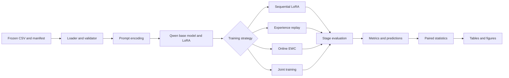

# Architecture

The repository separates frozen research inputs, training mechanisms, evaluation,
and presentation. Each module has one responsibility. The experiment runner joins
the modules through explicit configuration and serializable run records.

## Component responsibilities

- `rmt.data` loads the frozen CSV or package, validates hashes, checks leakage, and builds target-only prompts
- `rmt.models` initializes Qwen2.5-0.5B and attaches the single LoRA adapter
- `rmt.methods` owns the four strategy control flows and method-specific state
- `rmt.training` owns optimization, checkpointing, the 19-run schedule, failure records, and resume behavior
- `rmt.evaluation` owns classification metrics, continual-learning metrics, paired tests, and error summaries
- `rmt.reporting` owns deterministic examples, tables, Markdown output, and scientific figures

## Dependency direction

Data and configuration do not depend on model or reporting code. Methods depend on
small callable training and evaluation contracts. The runner depends on the method
interfaces, but method modules do not depend on the runner. Reporting reads result
files and does not modify model state.

## Result boundary

`results/raw/` is reserved for future model runs. `examples/results/` contains only
the deterministic package created by `scripts/generate_examples.py`. Each example
run file records `example_data: true` and the generator seed.

